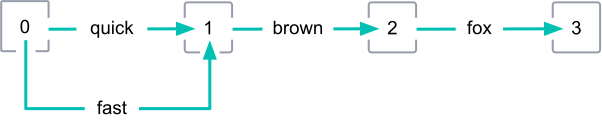
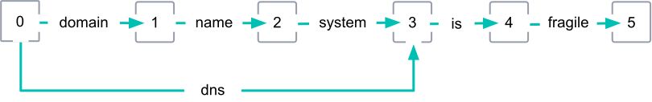
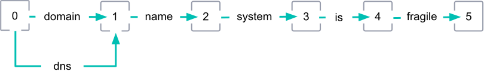

# 词元图

当分词器将文本转换为词元流时，它还会记录以下信息：

- 流中每个词元的**位置**（position）
- **positionLength**，即词元跨越的位置数量

利用这些信息，你可以为一个流创建一个有向无环图（directed acyclic graph），称为**词元图**（token graph）。在词元图中，每个位置代表一个节点。每个词元代表一条边或弧（edge or arc），指向下一个位置。

## 同义词

一些词元过滤器可以向现有词元流中添加新词元，比如同义词。这些同义词通常与现有词元跨越相同的位置。

在下图中，`quick` 及其同义词 `fast` 的位置都是 0。它们跨越相同的位置。

## 多位置词元

一些词元过滤器可以添加跨越多个位置的词元。其中包括多词同义词的词元，比如用 `atm` 作为 `automatic teller machine` 的同义词。

不过，只有部分词元过滤器（称为**图词元过滤器**，graph token filters）能准确记录多位置词元的 `positionLength`。这些过滤器包括：

- `synonym_graph`
- `word_delimiter_graph`

一些分词器（如 `nori_tokenizer`）也能准确地将复合词元分解为多位置词元。

在下图中，`domain name system` 及其同义词 `dns` 的位置都是 0。但 `dns` 的 `positionLength` 为 3。图中其他词元的 `positionLength` 均为默认值 1。

## 在搜索中使用词元图

索引会忽略 `positionLength` 属性，并且不支持包含多位置词元的词元图。

不过，`match` 或 `match_phrase` 等查询可以使用这些图从单个查询字符串生成多个子查询。

### 示例

用户使用 `match_phrase` 查询搜索以下短语：

`domain name system is fragile`

在搜索分析期间，`domain name system` 的同义词 `dns` 被添加到查询字符串的词元流中。`dns` 词元的 `positionLength` 为 3。

`match_phrase` 查询使用该图为以下短语生成子查询：

- `dns is fragile`
- `domain name system is fragile`

这意味着该查询会匹配包含 `dns is fragile` 或 `domain name system is fragile` 的文档。

## 无效的词元图

以下词元过滤器可以添加跨越多个位置的词元，但只能记录默认的 `positionLength`（即 1）：

- `synonym`
- `word_delimiter`

这意味着对于包含此类词元的流，这些过滤器将产生**无效的词元图**（invalid token graphs）。

在下图中，`dns` 是 `domain name system` 的多位置同义词。但 `dns` 的 `positionLength` 为默认值 1，导致图无效。

::::warning 警告
避免在搜索中使用无效的词元图。无效的图会导致意外的搜索结果。
::::

> [原文链接](https://www.elastic.co/guide/en/elasticsearch/reference/8.18/token-graphs.html)
